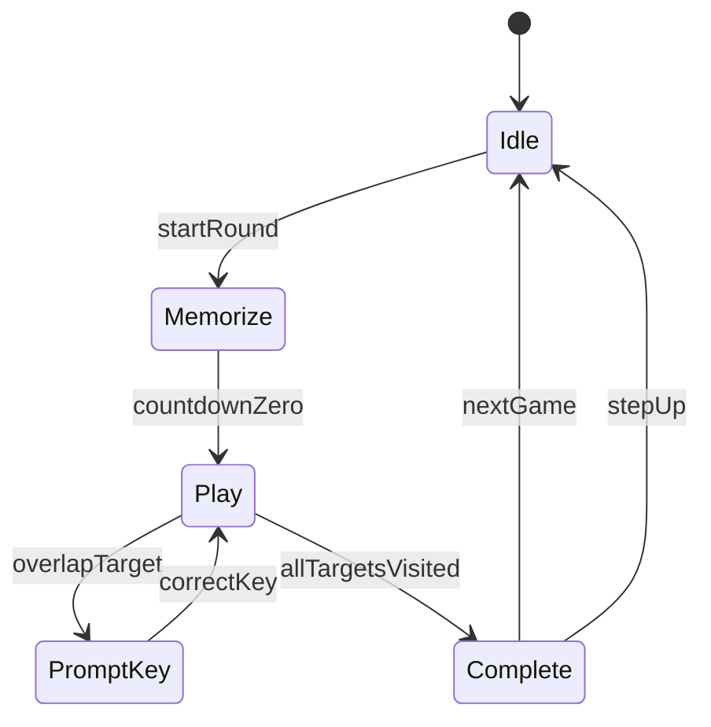

# Educational Memory Game

A browser-only memory game built with React, TypeScript, and Vite. Guide a monkey through scattered symbols in the exact order shown at the start of each round — training working memory and visual recall.

🎮 **Live demo:** [https://taan-sen.github.io/Educational_Memory_Game/](https://taan-sen.github.io/Educational_Memory_Game/)

## How to play

1. **Memorize** — A popup shows **X** symbols (letters, numbers, and shapes) in order, with a **5-second** countdown.
2. **Find** — When the countdown ends, **Y** symbols appear scattered on the playfield. If Y > X, the extra symbols are random decoys.
3. **Move** — Use **arrow keys** to walk the monkey out of his house (bottom-left corner).
4. **Visit in order** — Overlap the next target symbol by at least **30%**. A thought bubble prompts you to press a specific keyboard key.
5. **Confirm** — Press the correct key to place a green tick on that symbol, then move to the next one.
6. **Win** — Complete the full sequence to trigger a celebration, then choose **Next game** (same difficulty) or **Step up** (sequence length +1).

### UI controls

| Control | Location | Purpose |
|---------|----------|---------|
| **Sequence** button | Top-left | Re-show this round's memorized order |
| **Settings** gear | Bottom-right | Configure X (sequence length) and Y (symbols on screen) |

## Symbol pool

Each round draws randomly from:
- **Letters** — A to Z (26 options)
- **Numbers** — 0 to 9 (10 options)
- **Shapes** — square, rectangle, star, pentagon, hexagon, circle, oval, triangle (8 options)

Letters and numbers are always rendered upright with a random font and color each round. Shapes may be randomly rotated.

## Configuration

Defaults: **X = 2**, **Y = 2**. Settings are saved in `localStorage`.

| Setting | Rule |
|---------|------|
| X | Number of symbols to memorize and visit in order |
| Y | Total symbols on screen (Y ≥ X enforced) |

### Changing defaults and game rules

Edit [`src/config/gameConfig.ts`](src/config/gameConfig.ts):

| Key | Default | Description |
|-----|---------|-------------|
| `defaultSequenceLength` | `2` | Starting X |
| `defaultSymbolsOnScreen` | `2` | Starting Y |
| `countdownSeconds` | `5` | Memorize popup duration |
| `overlapThreshold` | `0.3` | Fraction of overlap needed to trigger key prompt |
| `entityMaxHeightVh` | `12.5` | Max size for symbols and monkey (1/8 viewport height) |
| `monkeySpeedPx` | `4` | Monkey movement speed in pixels per frame |

### Adding or removing shapes

Edit the `SHAPES` array in [`src/config/shapesRegistry.tsx`](src/config/shapesRegistry.tsx). Each entry needs an `id`, `label`, and an inline SVG `Component`.

### Changing the animal character

The monkey is rendered as an inline SVG component (`src/components/Monkey/MonkeySVG.tsx`) — no image files required. It uses CSS keyframe animations for the walking cycle (limb swing) and flips horizontally based on movement direction.

To swap the character, edit [`src/config/charactersRegistry.ts`](src/config/charactersRegistry.ts):
- Set `ACTIVE_CHARACTER` to a different entry
- Add new entries to `CHARACTERS` with `id` and `label`
- Replace `MonkeySVG.tsx` with a new SVG component for the new character

## Architecture



### Project structure

```
src/
├── config/          # gameConfig, shapesRegistry, charactersRegistry
├── types/           # TypeScript interfaces
├── engine/          # roundGenerator, collision, keyboardPrompt
├── hooks/           # useGame, useMonkeyMovement, useCountdown
├── components/      # UI: canvas, modal, monkey, settings, etc.
└── styles/          # global CSS
```

**Visual consistency** — [`SymbolRenderer`](src/components/SymbolRenderer/SymbolRenderer.tsx) is used in both the memorize popup and the playfield, so colors, fonts, rotation, and shape style always match between the two views.

## Local development

```bash
npm install
npm run dev
```

Open the URL shown in the terminal (usually `http://localhost:5173`).

### Production preview

```bash
npm run build
npm run preview
```

## Deployment (GitHub Pages)

This repo is pre-configured to deploy to `https://taan-sen.github.io/Educational_Memory_Game/`.

1. In repo **Settings → Pages**, set source to **GitHub Actions**.
2. Push to `main` — the workflow in [`.github/workflows/deploy.yml`](.github/workflows/deploy.yml) builds and deploys automatically.

To host under a different account or repo name, update `base` in [`vite.config.ts`](vite.config.ts) to match your repo name.

## Manual test checklist

- [ ] Default start: popup shows 2 items, 5 s countdown, then 2 symbols on screen
- [ ] Y > X: extra decoys appear; only sequence items accept visits in order
- [ ] Y < X: prevented in settings
- [ ] Popup symbols match field symbols (color, font, rotation, shape)
- [ ] Overlap < 30 %: no prompt; ≥ 30 %: thought bubble appears
- [ ] Wrong key: no tick; correct key: green tick, next target unlocks
- [ ] Step up: X increases by 1; Y auto-bumps if needed
- [ ] Monkey walking animation plays while moving; stops when idle
- [ ] Monkey flips direction correctly when moving left vs. right
- [ ] All entities ≤ 1/8 screen height
- [ ] Deployed site loads under `/Educational_Memory_Game/` base path

## Future extensions

- Sound effects and background music
- Touch / on-screen joystick controls for mobile
- Difficulty presets
- Additional animal characters
- Multiplayer or timed scoring modes
